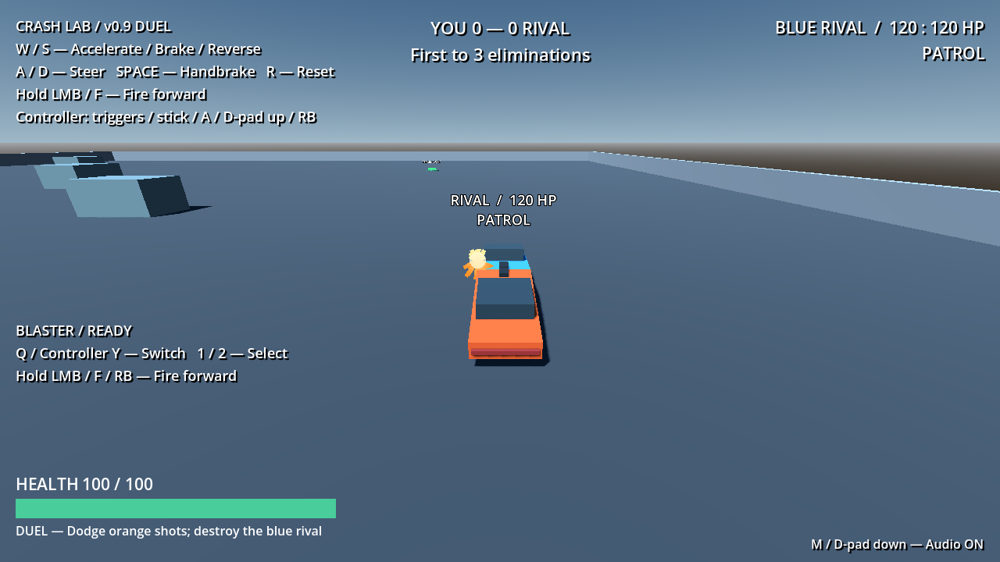

# Crash Lab v0.9 — Impact Lab

A small Godot 4 arcade vehicle combat playground for Windows PC. The default mode is a **first-to-three-eliminations match** against one blue moving rival, ending in victory, defeat, or a draw with an immediate replay option. Both vehicles share the rigid-body driving system, exchange projectile fire, collide physically, and respawn between non-final eliminations. The original continuous training playground remains available.

v0.9 adds physical collision telemetry, crash feedback and playtest refinements: more reliable event handling, thick moving sparks, stronger acceleration and modest speed-based FOV. Power is now **22,000 N**, with a **55 m/s power cutoff**. Mass, brakes, reverse cutoff, grip, suspension, damping, steering angles and their original 42 m/s fade reference remain intact, as do weapons, AI commands, health, scoring and repairs. Optional extra crash impulses default **off**. Physical collisions still cause **no health damage**. New feel/balance remains subject to human acceptance.

## Documentation

The tracked project documentation lives in this repository. Keep relevant documentation and the changelog updated in the **same pull request** as each code change.

- [Roadmap](docs/ROADMAP.md): development milestones and free-only GitHub Actions policy.
- [Architecture](docs/ARCHITECTURE.md): runtime systems, ownership, integration contracts.
- [Game design](docs/GAME_DESIGN.md): design pillars, implemented features versus experiments.
- [Physics](docs/PHYSICS.md): driving model, tuning defaults, collisions, recovery.
- [Testing](docs/TESTING.md): validation commands, test suites, manual playtests.
- [Free CI workflow](.github/workflows/godot-headless.yml): public-only Godot headless checks on a standard runner, without artifact/cache uploads.
- [Changelog](CHANGELOG.md): milestone history and unreleased work.
- [Pull request template](.github/PULL_REQUEST_TEMPLATE.md): required documentation and testing checklist.

## Run

1. Open `project.godot` with Godot 4.7.2 (the version validated for this prototype).
2. Press **F5** to launch `scenes/duel.tscn`. Drive, dodge the blue rival's orange shots, and line up your forward blaster. Scores and the elimination target appear at the top center, player health at the bottom left, and rival health/state at the top right and above the car.
3. The player starts at (-22, 1.25, 28), and the rival at (22, 1.25, -28). Solid boundaries and three spaced cover blocks provide maneuvering room. There is no active turret in the duel.
4. To revisit training, open `scenes/main.tscn` and press **F6**. The original runway, slalom, ramps, target dummy, and northeast turret remain there. The right-side firing range is centered on x = 48; the turret is at (40, 0, -103).
5. After a result, press **Enter** or **controller Start/Menu** to play again. Release the button before another deliberate restart press. R/D-pad remains vehicle recovery during play and never resets scores or restores health.
6. Use your normal Windows sound output. Press **M** or **D-pad down** to mute/unmute at any time, including the result screen. Audio status is shown at the bottom right; mute persists across scene restarts until the app closes.
7. Press **Q / controller Y (north face)** to cycle weapons, or **1 / 2** to select blaster/cannon directly. The left-side loadout HUD shows the selected weapon and readiness. Fire with the existing LMB/F/RB controls. Both weapons have unlimited ammunition.
8. Drive through a **green repair cross** when damaged to restore up to **25 HP**. Used pads turn gray and show their **12-second** return countdown. Full-health cars leave the pickup available; either living vehicle can collect. No button is required.

No external assets, plugins, or downloads are required. The project uses the Compatibility renderer and Godot Physics at 120 physics ticks per second. Earlier Godot 4 versions have not been validated.

| Action | Keyboard | Controller |
| --- | --- | --- |
| Accelerate | W | Right trigger |
| Brake, then reverse | S | Left trigger |
| Steer | A / D | Left stick |
| Handbrake | Space | South face button (Xbox A) |
| Reset to starting position | R | D-pad up |
| Hold to fire blaster | Left mouse button or F | Right shoulder (Xbox RB) |
| Restart finished match | Enter | Start / Menu |
| Mute / unmute audio | M | D-pad down |
| Cycle player weapon | Q | North face / Xbox Y |
| Select blaster / cannon | 1 / 2 | — |

Controller steering and triggers are analog, with a 0.15 deadzone. Bindings are editable in **Project Settings → Input Map**. Opposite pedal input brakes before changing direction. Releasing the pedals allows the car to coast.

## Impact Lab

No new controls. In training (F6 on `scenes/main.tscn`), compare a slow barrier bump, a fast wall crash and a glancing scrape. In duel (F5), try a head-on ram, a side ram and a rear-end collision. Crashes use **relative contact-point speed toward the surface**, so opposing cars combine their closing speeds while tangential speed contributes little. Severity is not a damage value.

| Setting on each car's `ImpactDetector` | Default |
| --- | --- |
| Minimum / moderate / major normal closing speed | 1.5 / 5 / 12 m/s |
| Separation before another event against the same body | 0.35 s |
| Minimum interval between severity upgrades for the same contact pair | 0.12 s (upgrade queued, not discarded) |
| Optional extra impulses | Disabled |
| Enabled impulse scale / linear cap / yaw cap | 0.04 / 700 N·s / 180 kg·m²/s |

Minor bumps get a short clatter and small spark burst. Moderate/major crashes get progressively longer cues and sparks, with camera offsets of **0.06 m for 0.18 s** and **0.18 m for 0.32 s** on the involved player's camera. Chase orientation, distance, smoothing and obstruction avoidance are unchanged. Offsets decay to zero; minor contacts never shake it. Scene effects are capped at eight bursts, each lasting at most **0.65 s**. Sparks now use a yellow-white center and **8/12/18 thick animated triangle streaks**, holding contrast before fading. They retain the contact's horizontal position but rise just above visible placeholder bodywork instead of being buried in the shallow chassis. M/D-pad down mutes crash cues with existing combat audio.

`Debug Output` on `ImpactDetector` prints event actor/collider paths, severity, world contact position/normal, relative velocity and closing speed. **Either vehicle's contact report** feeds one canonical pair owner (lower instance ID), so one-sided data is usable without duplicate pair effects. Manifold contacts coalesce to their strongest closing speed. A weak initial touch may upgrade once per higher severity category; the highest category never repeats while pushing. A distinct collider has its own episode and is not blocked by another collider's cooldown. Floor/ramp support normals with `abs(normal.y) > 0.65` are ignored, including hard landings. Recovery/respawn clears both sides' stale state and grants 0.35 s grace. Destruction and results cancel queued events/reactions, remove bursts and clear shake.

Start tuning feedback through the thresholds and camera offsets. Only try `Exaggeration Enabled` after comparing the default: extra impulses are one-shot central planar pushes and separately limited yaw torque, with no upward push or pitch/roll torque. Default caps add at most 0.5 m/s per body at the approved 1,400 kg mass. These effects are provisional; keyboard/controller feel and listening approval are still required. See [PHYSICS](docs/PHYSICS.md) for calculations and engine API references.



Playtest refinement comparison:

| Measurement (fixed 120 Hz, same physical controller) | Before | Refined |
| --- | ---: | ---: |
| Engine force / power cutoff | 15,000 N / 42 m/s | 22,000 N / 55 m/s |
| Training runway speed after 3 s | 18.46 m/s | 22.81 m/s (+24%) |
| Long straight speed after 6 s | 24.12 m/s | 30.93 m/s (+28%) |
| Long straight speed after 30 s | 26.01 m/s | 34.05 m/s (+31%) |
| Major spark lifetime | 0.42 s, thin lines | 0.65 s, thick moving streaks and center |
| FOV | Fixed 75° | Smooth 75–85° with speed |

The power cutoff is **not the measured top speed**: ordinary engine falloff and damping still apply. Steady straight-line requested/applied tire forces match, so the tire-force bound is not silently limiting that measurement. Camera exports: `base_fov` 75°, `speed_fov_increase` 10°, `speed_fov_start` 8 m/s, `speed_fov_full` 40 m/s and `speed_fov_response` 3/s. Set the increase to zero for a fixed view. No speed shake, motion blur or steering impairment is added.

[Before sparks](docs/images/impact-major-before.png) / [refined sparks at about 0.42 s](docs/images/impact-major-late.png). Both are normal chase-camera observations from controlled collision fixtures, not human approval.

## Arena repair pickups

| Scene | Pad | World position |
| --- | --- | --- |
| Duel | West repair | (-45, 0, 10) |
| Duel | East repair | (35, 0, -35) |
| Duel | South repair | (0, 0, 40) |
| Training | Repair practice | (-48, 0, 28), labeled on the ground nearby |

Each reusable `scenes/pickups/repair_pickup.tscn` instance exposes **Repair Amount** (25 HP), **Respawn Delay** (12 seconds), and **Collection Radius** (2 m). Restart after editing startup shape settings. Placements are clear of vehicle spawns, solid cover, and original training routes. Pads have no solid collision or physical force and cannot block or push a car.

An available pad queries actual physical vehicle overlaps every physics step. The upright cylindrical collection volume is 2.5 m high; its radius is measured around the pad, and any overlapping part of the physical chassis can trigger collection. Areas/hurtboxes, projectiles, static obstacles, destroyed vehicles, and combat-disabled vehicles cannot collect. Full-health vehicles are filtered out before choosing a collector. If several eligible vehicles overlap, the nearest chassis center in 3D wins. Exact distance ties use lexical scene paths (in the duel, Player precedes Rival). Body candidates are deduplicated, and availability is disabled before health callbacks, preventing double/reentrant collection.

The health component's `restore_health(amount)` accepts only finite positive amounts for living, combat-active vehicles, clamps to that vehicle's maximum, and returns actual restored health. A partial repair near full health consumes the pad but reports only the restored amount. No actual restoration means no consumption or timer reset. The API emits a health update without damage, destruction, respawn, or score events. Shield time, loadout, cooldowns, and reset commands are untouched. It cannot revive a wreck.

Used pads hide their green cross, turn gray, and display a return countdown. A full-health car may stay on an available pad and collect if later damaged. A damaged car camping an unavailable pad may collect immediately when it returns; the 12-second delay limits this intentional point-control behavior. Repair and damage follow normal physics processing order: a vehicle already destroyed when the pad evaluates is ineligible. The approved same-tick elimination rules are unchanged.

Player collection shows a brief **REPAIRED +actual HP** message above the health bar and a centered repair cue. Rival collection shows a separate world message above that car and a positional cue. Restoring health does not trigger existing hit/damage sounds or reuse respawn audio. M/D-pad down mute still applies. The rival can collect incidentally but its navigation has no pickup-seeking behavior.

At a duel result, pads disable collection and return timers, health rejects restoration, and temporary repair messages clear. Even queued collection calls and pickups added to an already finished duel are blocked. Scene restart recreates every pad available with clean timers and observers. Training has no match controller, so its demo pickup returns continuously.

The default 25 HP / 12-second values and placements are starting points for human tactical/balance playtesting. No ammo, armor, shield, speed, random-drop, inventory, or automatic health-regeneration system is included.

## Player loadout

Both duel and training use `player_car.tscn`, which inherits the approved muscle-car chassis and adds a cannon and loadout controller. The rival still inherits the original single-weapon muscle car and has no cannon or player selection controller.

| Weapon | Damage | Cadence | Projectile speed | Lifetime | Feedback |
| --- | --- | --- | --- | --- | --- |
| Blaster | 20 HP | 7 shots/s | 110 m/s | 2 s | Original cyan shot and blaster sound |
| Heavy cannon | 80 HP | 0.8 shots/s | 65 m/s | 2.5 s | Larger violet projectile, violet barrel, lower heavy shot cue |

The cannon is a direct-hit weapon with no splash damage, recoil, charge, homing, or aim assist. Its starting values are provisional and need human balance feedback. The original blaster retains its approved sustained-fire behavior; the cannon offers a stronger opening hit with a 1.25-second cooldown. The rival's original weapon and AI settings are unchanged.

Selection starts on blaster. Only the selected weapon is visible and consumes fire input. Holding fire continues firing the selected weapon when ready. Each slot keeps counting down while holstered, so switching away and back does not refresh its cooldown. A loadout-level guard prevents two player shots in the same physics tick even if selection changes between firing calls. Cycling is release-gated. For simultaneous inputs, direct slot 1 takes precedence over slot 2, and either direct choice takes precedence over cycle.

Dead players and finished matches ignore selection and cannot fire either weapon. Ordinary respawn selects blaster again; existing cooldowns continue rather than receiving a selection-based refill. Manual recovery preserves the selected slot, cooldowns, and health. Match restart rebuilds default blaster selection and clean cooldowns for both slots. Match completion stops both the active and holstered weapon permanently until restart.

Tune cannon damage, fire rate, speed, lifetime, projectile color/size, display name, and shot-cue override on **Player → HeavyCannon** (or **MuscleCar → HeavyCannon** in training). Defaults live in `scenes/weapons/heavy_cannon.tscn`. Empty shot-cue overrides preserve the existing player/enemy sound selection. The projectile collision shape remains a zero-width swept ray; the larger cannon mesh is visual only.

Input mapping stays in the player command provider. `player_loadout.gd` consumes selection requests before weapons run, manages active flags, and coordinates lifecycle hooks. Temporary selection is separate from the permanent match-end firing flag; holstering never stops cooldown updates. The original `Blaster` path remains compatible with existing AI and regression fixtures.

## Combat audio

The same scene-local audio observer serves both duel and training. Existing weapon, health, and match signals trigger sound; projectiles report collision positions through their firing weapon. Audio never changes damage, cadence, movement, scoring, or AI, and synthesis uses its own seeded RNG rather than gameplay randomness.

| Event | Feedback |
| --- | --- |
| Player shot | Bright descending blaster sound at the muzzle |
| Rival/turret shot | Lower pitched blaster sound at the muzzle |
| Heavy cannon shot | Lower heavy pulse at the muzzle |
| Projectile collision | Short world impact; missed shots expire silently |
| Accepted opponent/target damage | World hit sound at the damaged actor |
| Accepted player damage | Centered damage cue |
| Destruction | World destruction burst |
| Respawn | World cue for other actors; centered cue for the player |
| Repair pickup | Distinct centered player cue or world-positioned rival cue |
| Victory / Defeat / Draw | Three distinct centered result phrases |

Protected/rejected damage does not trigger a damage cue, and healing does not create false hit feedback. Muzzle and impact flashes remain as before. Match completion stops combat sounds and plays its result cue once; late combat cues are blocked until restart. Muting stops current voices immediately and suppresses new playback without changing gameplay. Unmuting does not replay an old result.

Select **CombatAudio** in either scene to tune startup **Volume Db** (default -16 dB), **World Voice Limit** (12), and **UI Voice Limit** (3). Restart after changing startup settings. Spatial sounds use distance attenuation with a 100 m cutoff and a close-range gain cap. Impact bursts are limited to one cue per 0.04 seconds. Pools reuse existing players and replace the oldest slot when full; there is no unbounded node allocation during sustained fire.

`sound_bank.gd` generates twelve original mono 22,050 Hz, 16-bit PCM cues with short envelopes, controlled sample peaks, and no external assets. Streams are cached once per app session. These are intentionally simple synthesized placeholders. There is no music, engine loop, tire/collision audio, acoustic occlusion, or volume/settings menu. Perceived loudness, positioning, fatigue, and cue quality need human listening on speakers/headphones.

## Match rules and lifecycle

A fresh duel automatically starts **Playing**, with scores at zero. Destroying the rival awards one player elimination; destroying the player awards one rival elimination. Each destruction is credited once until that vehicle respawns. The first participant to reach **three** wins. Change **Duel → MatchController → Elimination Target** to configure the target. It is a scene setting; save it before launching if it should persist across restarts.

Eliminations are grouped by the physics tick in which destruction signals occur. At the next physics boundary the controller resolves the completed tick as a batch, regardless of callback order. Both valid eliminations receive points. If both reach the target in that tick, the result is **Draw**; if only one reaches it, that participant wins. A result normally appears within one 120 Hz physics step of the decisive destruction. There are no rounds or match timer.

Non-final eliminations retain existing destruction countdowns, safe spawn checks, and spawn protection. At the winning elimination, the match becomes **Finished** and shows **Victory**, **Defeat**, or **Draw**, final scores, and restart controls. Both cars freeze in place with zero momentum. Damage is rejected, health timers stop, pending respawns and recovery resets are cancelled, input providers stop, and weapons reject firing. Existing projectiles and muzzle/impact flashes are removed. The camera and arena remain visible behind the result overlay. The physics tree is not globally paused, so restart input remains available.

Restart reloads the duel scene: scores, health, vehicles, AI state, cooldowns, effects, signal connections, and the result display are rebuilt. Both cars return to their original clear starting positions with the original initial protection state (no initial shield; protection still applies after ordinary respawns). Held physical driving inputs can naturally become active again in the new match. Restart works only while Finished, only once per request, and requires release after a reload to avoid a held key skipping a later result.

Match rules are local to `duel.tscn`. Training has no match controller, scoring, or result gate and continues to respawn practice actors indefinitely.

### Architecture

`scripts/match/duel_match.gd` owns scoring, completed-tick event batches, Playing/Finished state, result, and restart. It connects to health destruction/respawn signals rather than polling zero health. `scripts/debug/match_hud.gd` observes score/result signals and owns their presentation.

On completion the controller calls the participants' explicit `finish_combat()` hook. Vehicle, health, input, weapon and impact components stop their responsibilities; health and weapons retain durable guards against further damage or direct firing calls. The chassis ignores reset/force work after completion. Training never invokes these hooks. No global match singleton or pause is introduced. Geometry, masks, projectile tuning, AI logic and existing controls remain; v0.9's explicitly requested power/FOV changes are documented above.

## Structure

- `scenes/duel.tscn`, `scripts/duel_arena.gd`: default duel with one player, one rival, cover, and boundaries.
- `scenes/main.tscn`: original v0.3 training scene, vehicle, camera, and debug overlay.
- `scenes/test_arena.tscn`, `scripts/arena.gd`: sky, lighting, and procedural static arena geometry.
- `scenes/vehicles/muscle_car.tscn`: reusable rigid chassis and player input provider.
- `scripts/vehicles/vehicle_controller.gd`: force-based driving, suspension, placeholder visuals, and recovery.
- `scripts/vehicles/player_vehicle_input.gd`: converts mapped inputs into commands; a future AI or network provider can expose the same fields.
- `scripts/camera/chase_camera.gd`: smoothed chase camera with upright heading and obstacle ray query.
- `scripts/debug/driving_debug.gd`: speed, direction, handbrake, grounded wheel count, and controls.
- `tests/driving_smoke.gd`: executable physics regression checks.
- `scenes/weapons/blaster.tscn`, `scripts/weapons/vehicle_weapon.gd`: front barrel, muzzle, tuning, and firing cooldown.
- `scripts/weapons/projectile.gd`, `hit_flash.gd`: visible swept projectiles and short-lived muzzle/impact flashes.
- `scenes/targets/target_dummy.tscn`, `scripts/targets/target_dummy.gd`: solid damage receiver, health display, hit flash, destroyed state, and automatic respawn.
- `tests/weapon_smoke.gd`: weapon, target, collision, and driving-with-fire integration checks.
- `scripts/combat/vehicle_health.gd`: separate player damage receiver, destruction, input lock, and protected respawn.
- `scenes/enemies/stationary_turret.tscn`, `scripts/enemies/stationary_turret.gd`: stationary tracking enemy that reuses target health/respawn and the existing weapon.
- `scripts/debug/combat_hud.gd`: player health bar, hit overlay, death countdown, and turret warning/status.
- `tests/combat_smoke.gd`: player damage, cover, destruction, recovery, turret defeat, and repeat combat checks.
- `scenes/vehicles/rival_car.tscn`, `scripts/enemies/rival_driver.gd`: inherited muscle car with blue visuals and an AI command provider.
- `scripts/combat/vehicle_hurtbox.gd`: projectile-only area covering the visible body/roof, without changing the physical chassis.
- `scripts/debug/rival_hud.gd`: duel controls, rival name/health/state, and floating nameplate.
- `tests/rival_smoke.gd`, `rival_soak.gd`: deterministic duel checks and a one-minute unattended encounter.
- `scripts/match/duel_match.gd`, `scripts/debug/match_hud.gd`: duel scoring, result lifecycle, keyboard/controller restart, and match UI.
- `tests/match_smoke.gd`, `tests/fixtures/tick_damage.gd`: match/restart checks, including real damage callbacks before and after the controller in one physics tick.
- `scripts/audio/sound_bank.gd`, `combat_audio.gd`: original procedural cues, scene signal wiring, bounded spatial/centered playback pools, mute, and result/restart lifecycle.
- `tests/audio_smoke.gd`: waveform, event dispatch, rate limiting, mute, playback, and lifecycle checks.
- `scenes/vehicles/player_car.tscn`, `scenes/weapons/heavy_cannon.tscn`: player-specific inherited loadout and configurable cannon; rival inheritance stays unchanged.
- `scripts/weapons/player_loadout.gd`, `scripts/debug/loadout_hud.gd`: selection, per-tick firing ownership, lifecycle handling, and selected-weapon/cooldown feedback.
- `tests/loadout_smoke.gd`: mapped switching, firing exclusivity, cooldowns, cannon collisions/audio, and lifecycle checks.
- `scenes/pickups/repair_pickup.tscn`, `scripts/pickups/repair_pickup.gd`: reusable non-solid repair pad, overlap arbitration, countdown, and match-end guard.
- `scripts/debug/repair_feedback.gd`: actual-amount player/rival messages, independent of existing weapon/score HUD.
- `tests/repair_smoke.gd`: restoration API, real physics overlaps, simultaneous collectors, repeated collection/respawn, audio, match shutdown, reload, and training checks.
- `tests/run_checks.ps1`: editor/startup validation and all nine suites; also rejects Godot runtime errors even when the engine exits with code zero.

## Rival behavior and tuning

The rival inherits the muscle car's physics, weapon, and health components. Its `DriverInput` node runs `rival_driver.gd`, which supplies the existing throttle/brake/steering/fire/reset commands and never reads player input. The vehicle controller still performs all physical movement. The rival has **120 HP**, a **four-second** destruction delay, and **1.5 seconds** of spawn protection. Enemy shots travel at **28 m/s**, deal **10 HP**, and fire at **0.8 shots/s**; player blaster settings are unchanged.

Outside engagement range, or when the player is hidden, destroyed, or protected, it patrols four world-space waypoints. A visible living player within **60 m** triggers pursuit. It slows for turns, aims for **14 m/s** on straights, and reduces speed within a **10 m** following distance. If too close with the barrel off target, it briefly reverses to regain turning room. Shooting requires a clear muzzle-to-player view, range within **35 m**, and a forward aim error of at most **9 degrees**. It has no turret, homing, or predictive aiming.

Three short obstacle rays steer toward the clearer side and reduce speed. Sustained low progress for **two seconds** triggers **1.6 seconds** of reverse recovery. Three failed recovery attempts request a safe reset; sustained rollover also requests a reset after **four seconds**. Ordinary forward progress clears failed attempts. Resets use the physics integration path, never per-frame teleport following. AI state, firing commands, cooldown, and recovery timers clear on respawn.

Tune engagement range, desired speed, following distance, firing range, aim tolerance, fire cadence, obstacle lookahead, stuck delay, reverse duration, rollover delay, failed-attempt count, and patrol points on **Rival → DriverInput**. Patrol points are world positions. Tune enemy projectile settings on **Rival → Blaster** and health/respawn on **Rival → DamageReceiver**. The AI applies `fire_cadence` to its weapon at startup. Restart after changing startup settings.

### Collision, damage, and safe spawning

Both cars use physical layer 2 and now include layer 2 in their collision masks, so collisions transfer momentum instead of allowing cars to pass through. Collisions do not cause health damage. The short chassis collider, mass, center of mass, driving forces, steering, traction, suspension, and damping retain their approved values. Body color is an exported visual setting; the player keeps its original orange default.

The visible roof extends above the physical chassis. A separate damage-only area on layer 3 covers the body/roof so level forward shots can hit the opponent without raising the physical collider. Projectile sweeps include this layer and exclude both the shooter's rigid body and its damage areas. This is a simple box approximation, not detailed damage.

All vehicle reset requests check the spawn chassis shape with a 0.3 m margin against arena/vehicle colliders. Destroyed vehicles wait with controls and firing disabled if their own spawn is occupied. Health and protection restore only after physics integration confirms a completed reset. Move off an occupied spawn to let its owner return; there is no forced overlap or alternate-spawn teleport. Each car returns to its own initial spawn. Manual recovery does not heal. The turret and dummy retain their existing in-place respawn behavior in training.

Camera distance, height, response, and smoothing settings are preserved. Long duel tests exposed a floating-point axis error in planar vector interpolation during heading reversals; the implementation now interpolates the equivalent yaw angle to keep the same smoothing without that error.

## Combat loop and tuning

The player starts with **100 HP**. Orange turret shots deal **15 HP**, travel at **26 m/s**, and fire at **0.75 shots/s**. The stationary turret smoothly aims at the player's current position without predicting movement. It requires an unobstructed view within **38 m**, alignment, and a **one-second warning** before firing. The HUD announces locking/firing, and the turret has a floating health/status label. Cover, range, player destruction, or spawn protection breaks its lock; reacquiring requires another warning. Projectiles already in flight continue normally.

In training, the turret has **120 HP** (six default blaster hits) and returns **six seconds** after destruction. Its gun hides and stops firing while destroyed. Player death darkens the car, disables driving/firing/reset input, and shows a **three-second respawn countdown**. The wreck retains physical momentum while waiting. Automatic respawn requests the existing physics reset, clearing momentum at the player's original spawn and restoring full health with **1.5 seconds of damage protection**, subject to spawn clearance. Normal R/D-pad recovery does not restore health. Physical collisions do not cause health damage in this milestone.

Tune player health, respawn delay, and protection on **MuscleCar → DamageReceiver**. Tune turret health, respawn delay, range, warning time, and aim response on **EnemyTurret**. Open its scene to tune **Head → Blaster** projectile speed, damage, cadence, lifetime, and orange color. Player blaster defaults, all chassis driving parameters, and the camera are preserved. The health component only gates input during destruction and issues the existing reset command; it does not retune physics.

## Weapon and target tuning

Select **Player → Blaster** in the duel (or **MuscleCar → Blaster** in training) to tune fire rate (7 shots/s), projectile speed (110 m/s), damage (20 HP), and lifetime (2 seconds). Ammo is unlimited. The weapon reads `fire_requested` from the input provider and has no recoil or influence on chassis physics. Established player driving and weapon settings are preserved.

Player shots follow the front barrel's forward direction in world space, including chassis pitch on ramps. There is no screen-center aim correction, player turret, homing, inherited chassis velocity, or gravity. Every physics tick sweeps a ray from the previous position to the next, using collision layers 1 (arena/targets/turret), 2 (vehicles), and 3 (damage areas). The firing body and its areas are excluded, and rays detect starting inside other solid obstacles. The first hit stops the shot. Damage calls `take_damage(amount)` on the collider/area or its `DamageReceiver` child, allowing health to remain separate from vehicle physics. Shots disappear on impact or expiry. Cyan player and orange enemy tracers are visual; collision uses a zero-width ray.

Open `scenes/targets/target_dummy.tscn` to tune maximum health (100 HP) and respawn delay (3 seconds). Health and respawn countdown appear above the target. Hits briefly flash white; destruction leaves a dark flattened placeholder and temporarily disables its collider. Respawn restores health, appearance, and collision. Physical car collisions do not invoke damage. Health, destruction, and respawn signals support future HUD or combatants without coupling them to the weapon.

## Physics and tuning

The 1,400 kg `RigidBody3D` chassis has a box collider, continuous collision detection, and a lowered center of mass. Four downward contact rays apply spring/damper suspension forces. Each tire applies lateral velocity correction and longitudinal drive/braking forces, limited by the suspension load. Front tire directions steer; their lateral forces turn the chassis physically. Rear tire grip drops under the handbrake. No per-frame chassis teleporting is used; recovery explicitly restores the spawn transform and clears velocity inside physics integration.

Select **MuscleCar** in training or **Player/Rival** in duel to inspect exported parameters. Shared defaults now include **22,000 N** engine force, unchanged **24,000 N** brakes, **55 m/s** forward power cutoff and **13 m/s** reverse cutoff. Steering keeps its original **42 m/s** fade reference, independent of power cutoff. Grip, tire-force limit, mass, damping, suspension and recovery settings are unchanged. Power cutoffs are not attained speeds or hard clamps; slopes/impacts can carry a car faster. Restart after changing startup mass/damping settings.

Camera distance, height, heading response, and position smoothing are exported on **ChaseCamera**. Debug speed is total velocity in km/h; direction uses the chassis forward velocity. Grounded counts suspension contacts, so a car resting on its roof may show zero.

## Validation

Validated with the existing Windows Godot **4.7.2.stable.official.ed1daf0bf** installation. Substitute your local executable for `godot` below; no machine-specific engine path is stored in the project.

```powershell
godot --version
godot --headless --path . --editor --quit
godot --headless --path . --quit-after 180
godot --headless --path . --fixed-fps 120 --script res://tests/driving_smoke.gd
godot --headless --path . --fixed-fps 120 --script res://tests/weapon_smoke.gd
godot --headless --path . --fixed-fps 120 --script res://tests/combat_smoke.gd
godot --headless --path . --fixed-fps 120 --script res://tests/rival_smoke.gd
godot --headless --path . --fixed-fps 120 --script res://tests/rival_soak.gd
godot --headless --path . --fixed-fps 120 --script res://tests/match_smoke.gd
godot --headless --path . --fixed-fps 120 --script res://tests/audio_smoke.gd
godot --headless --path . --fixed-fps 120 --script res://tests/loadout_smoke.gd
godot --headless --path . --fixed-fps 120 --script res://tests/repair_smoke.gd
godot --headless --path . --fixed-fps 120 --script res://tests/impact_smoke.gd
```

On Windows, run everything with `./tests/run_checks.ps1 -Godot 'FULL_PATH_TO_YOUR_GODOT_EXECUTABLE'`. The runner fails on nonzero exit codes and reported script/runtime errors. The new suites have explicit simulated-time watchdogs and bounded physics loops.

Editor import and headless launch completed without script or scene errors. The physics suite checks four-wheel settling, measured old/new acceleration, braking, reverse, steering, handbrake, recovery, barriers, upright ramp landing, sustained straight speed and speed FOV. It uses synthetic Input Map actions with a 120-second simulated watchdog and nonzero failure exits. Refined runway acceleration reaches **22.81 m/s after three seconds**, previously 18.46. These checks verify behavior, not enjoyable driving feel.

For the refined v0.9, all **256 behavior checks** pass locally, including **19 driving** and **55 impact** checks. Original low-speed/head-on/glancing/rear fixtures remain; new actual physics checks cover one-sided sensor data, minor-to-major escalation without spam, distinct wall contacts within 0.12 s, 55 m/s opposing/side/rear/glancing crashes, and a 0.15 m wall. The opposing-car fixture reports **107.99 m/s closing speed**, exactly one major event, ~4.27 m final separation and upright cars. Spark geometry, thickness, movement/fade, 0.65 s expiry and surface projection are also checked. Weapon, health, score, repair and restart regressions pass. See [TESTING](docs/TESTING.md) for evidence and CI reporting.

The **60-second default duel simulation** passes: the rival travels **149.65 m**, stays upright **7,200/7,200** frames, needs **zero resets**, fires **13 shots** and destroys the stationary player once, score **0–1**. The original-power observation was 235.26 m, 27 shots and two deaths; higher power changes the encounter trajectory even though AI commands and its 14 m/s desired speed are unchanged. Tests require stable movement, firing, destruction and consistent scoring, not an exact chase route. Balance/fairness still needs human testing.

The user approved human playtests through v0.8. A graphical Windows v0.9 inspection captured an actual head-on collision with one visible spark burst and full health on both cars. A graphics stress probe reached the eight-burst cap, expired all bursts, and cleared bursts/shake at the result screen; training also loaded without reported runtime errors. These are presentation/lifecycle observations, not human driving or listening approval. Impact feel, audio balance and physical-controller playtests remain pending.

### Human playtest checklist

- Compare slow bumps, fast head-on, side/rear rams and glancing scrapes; check feedback strength and prompt return of control.
- Try a minor touch followed by a forceful impact, rapid hits on different obstacles and repeated separated rams; check no lost feedback or sustained-contact spam.
- Judge improved acceleration, high-speed braking, handbrake and the smooth FOV widening on keyboard and controller; compare aiming comfort and rival fairness.
- Check that thick sparks are obvious from the normal chase view without hiding targets; assess the 0.65 s major duration.
- Hold against a wall and drive the runway/ramps: no repeated crash noise or shake during ordinary driving.
- Compare crash sounds with projectile sounds; test mute and assess camera comfort on keyboard and controller.
- Destroy/respawn, recover with R/D-pad up, finish/restart and repeat in training; check no lingering effects.
- Leave optional exaggeration off initially; if testing it, watch for spinning, lift or loss of responsiveness.
- Find and drive over green repair pads using keyboard/controller; check readability at driving speed.
- Confirm one bounded repair per collection, partial healing near maximum, and no consumption at full health.
- Let the rival collect incidentally; check its message/cue cannot be mistaken for your own repair.
- Wait through a return countdown and try camping or contesting a pad; assess whether this creates movement decisions or excessive stalling.
- Finish/restart matches and revisit training; check pad lifecycle and mute remain reliable.
- Confirm the approved driving, weapon switching, rival, and match behavior still feel right.

### Known limits

Suspension rays only contact static arena layer 1; tires are visual placeholders without rolling collision or wheel spin. There is no drivetrain/gearing simulation or advanced tire model. The player uses manual rollover recovery; the AI has a delayed recovery reset. The camera checks the desired chase line against the arena with a simple ray rather than a swept camera volume.

Visual feedback remains simple geometry; audio is procedural placeholder synthesis. Projectiles use zero-width sweeps against current collider positions, and fire cadence is quantized to physics ticks. Dummy/turret respawn restores solid collision in place in training; non-final vehicle respawns wait for spawn clearance. Rival navigation remains local, with no pickup seeking. Repair pads query up to 32 body-shape overlaps per tick, sufficient for this two-car arena, and exact distance ties favor lexical scene paths. Pickups are fixed and their radius/repair/delay values are provisional; no ammo/armor/shield pickups, regeneration, inventory, random drops, AI weapon switching, progression, or multiplayer is added. Sound lacks wall occlusion and bounded pools can truncate older cues. Human tactical/balance and listening tests remain necessary.
